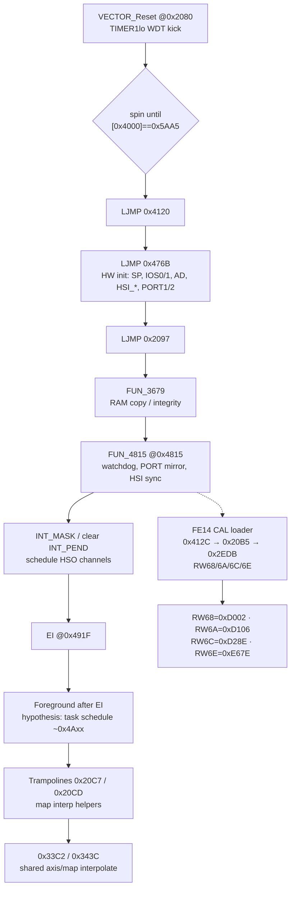
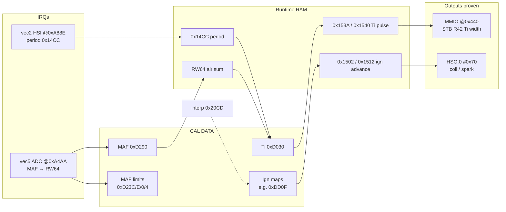
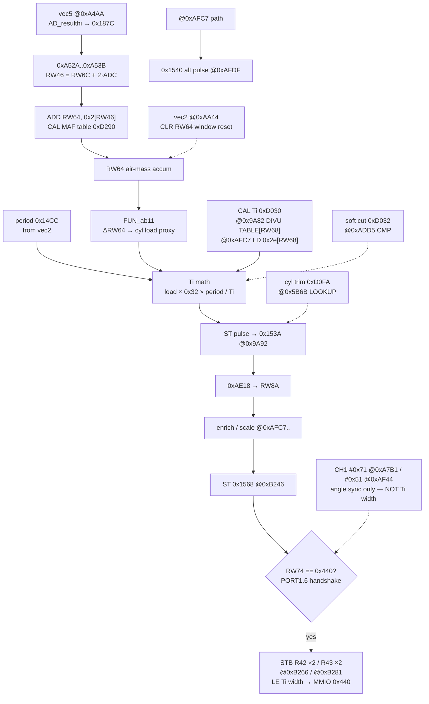
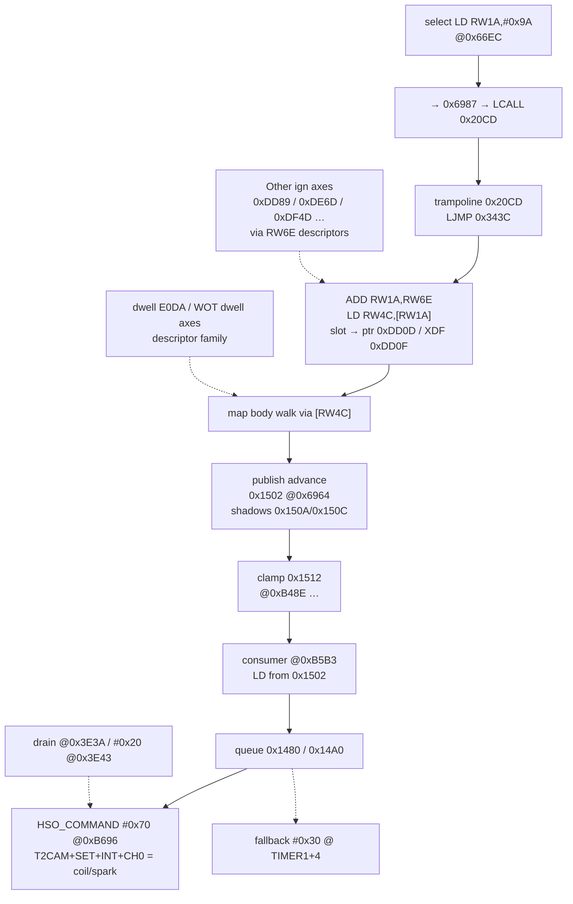
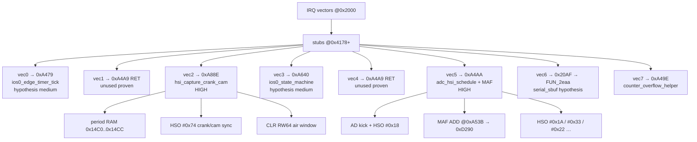
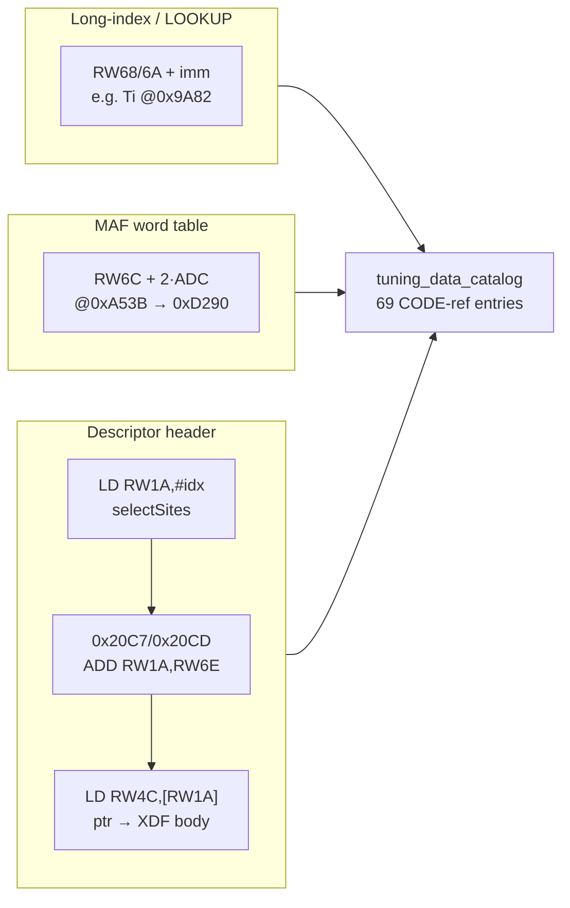

# Engine control flowcharts — RedLabel MCS-96

ROM: `BMW DME413 SW623 D466.29 C16x900A 94 RedLabel.bin`  
Addressing: FE14 CAL bases (`RW68=0xD002`, `RW6A=0xD106`, `RW6C=0xD28E`, `RW6E=0xE67E`)

> Research-only Mermaid views of proven CODE paths. Nodes carry absolute addresses. CAL reads link to [`tuning_data_catalog.md`](tuning_data_catalog.md). Do **not** invent unproven actuator pin maps. Do **not** auto-promote shipping packs.

**Legend:** solid edges = CODE-proven; dashed = hypothesis / open. Actuator close: **Ign → HSO.0 `#0x70`**; **Ti → MMIO `@0x440`** (not HSO width).

---

## 1. Boot → foreground init → enable IRQs

CAL catalog: all long-index / descriptor items depend on FE14 bases — see [tuning catalog](tuning_data_catalog.md).

---

## 2. Main control sketch (sensors → cal → actuators)

---

## 3. Fuel path — MAF / load → Ti → `@0x440`

| CAL item | Catalog |
|----------|---------|
| `0xD290` MAF | [`tuning_data_catalog.md`](tuning_data_catalog.md) domain `sensor` |
| `0xD030` Ti | catalog domain `fuel` |
| `0xD0FA` cyl trim | catalog domain `fuel` |
| `0xD032` soft cut | catalog domain `fuel` |

Full fuel/ign axes: see catalog domains `fuel` / `ignition`.

---

## 4. Ignition path — maps → advance RAM → HSO.0

| CAL item | Role | Catalog |
|----------|------|---------|
| `0xDD0F` | Ign WOT VANOS-ret RPM axis (**proven** select path) | [catalog](tuning_data_catalog.md) |
| `0xDD89` / `0xDE6D` / `0xDF4D` | Sibling ign RPM axes | catalog `ignition` |
| `0xE0DA` | Coil voltage/dwell table | catalog `ignition` |

---

## 5. IRQ vector bank

IRQ roles for vec0/3/6/7 are **hypotheses**; vec2/vec5 targets and MAF absolute read are **proven**. Details: [`irq_ram_publications.md`](irq_ram_publications.md), [`control_loops.md`](control_loops.md).

---

## 6. CAL read mechanisms (how catalog CODE refs work)

---

## Flowchart index

| # | Diagram | Focus |
|---|---------|--------|
| 1 | Boot → EI | Reset, HW init, FE14 bases |
| 2 | End-to-end sketch | Sensors → CAL → HSO.0 / 0x440 |
| 3 | Fuel path | MAF → Ti → MMIO 0x440 |
| 4 | Ignition path | Descriptor → advance → HSO.0 |
| 5 | IRQ bank | Vectors + proven vec2/vec5 pubs |
| 6 | CAL mechanisms | Long-index / MAF / descriptor |

**Flowchart count: 6**

---

## Related

- [`tuning_data_catalog.md`](tuning_data_catalog.md) / [`tuning_data_catalog.json`](tuning_data_catalog.json)
- [`engine_control_dataflow_summary.md`](engine_control_dataflow_summary.md) — summary + actuator close
- [`mmio_440_injector_protocol.md`](mmio_440_injector_protocol.md)
- [`absolute_code_reads.json`](absolute_code_reads.json)
- [`ignition_fuel_dataflow.md`](ignition_fuel_dataflow.md)
- [`sfr_hso_hsi_audit.md`](sfr_hso_hsi_audit.md)

---
Research-only. Verification gates for promotion unchanged.
